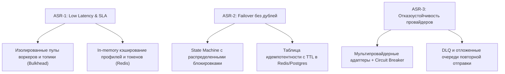
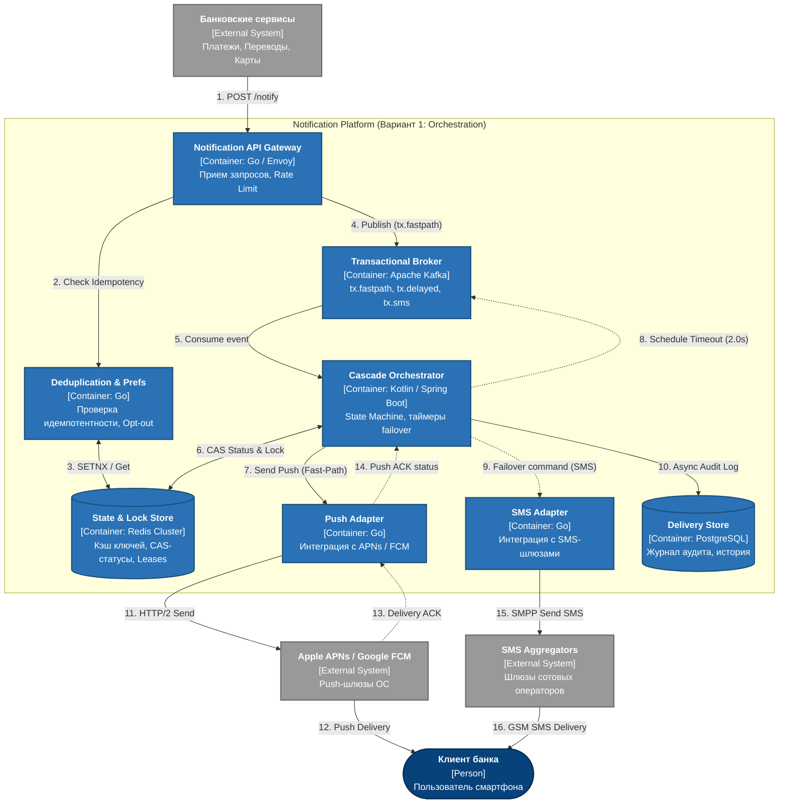
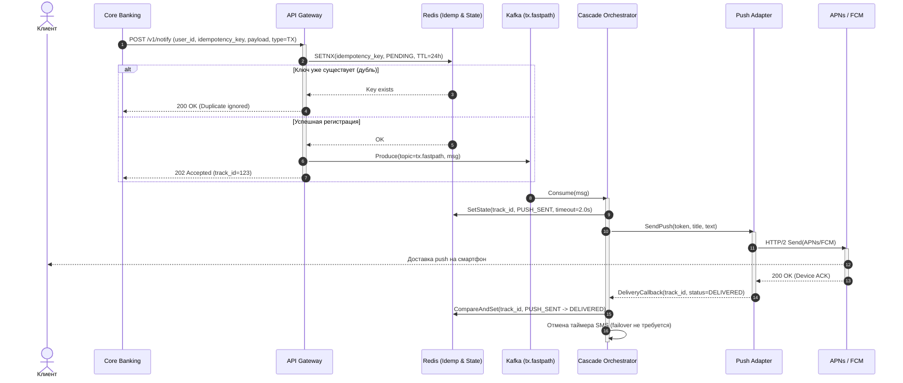
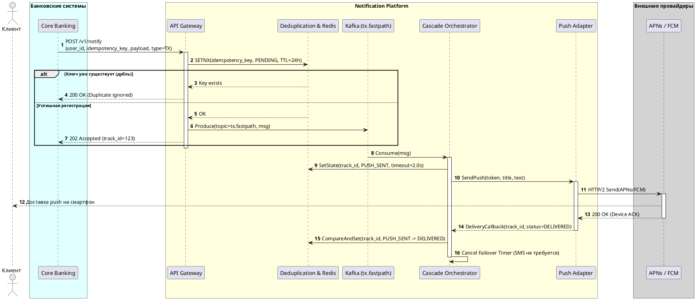
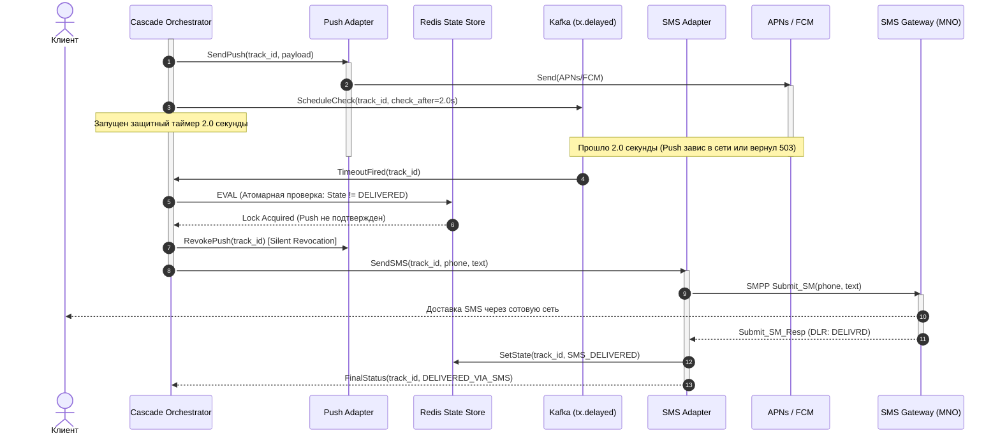
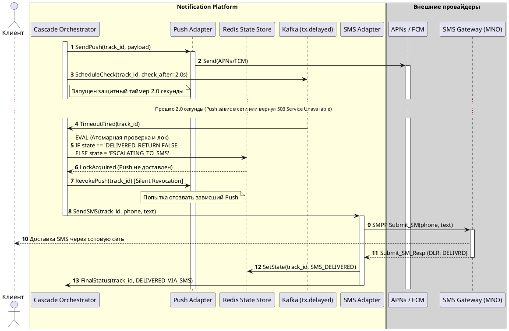
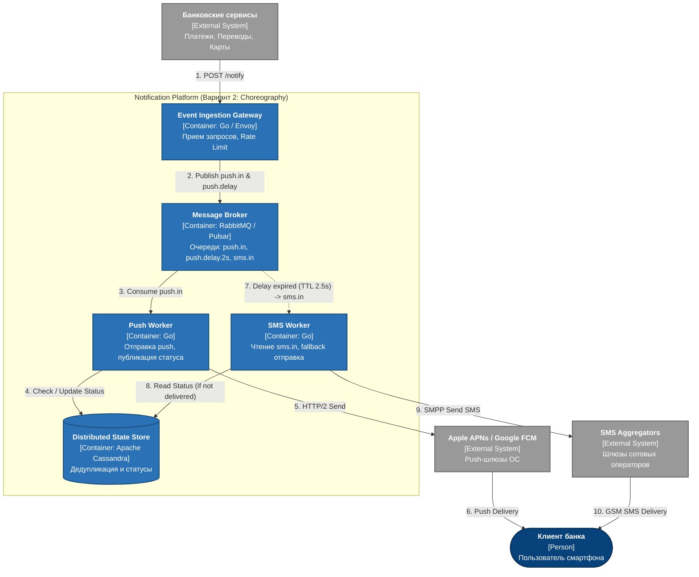
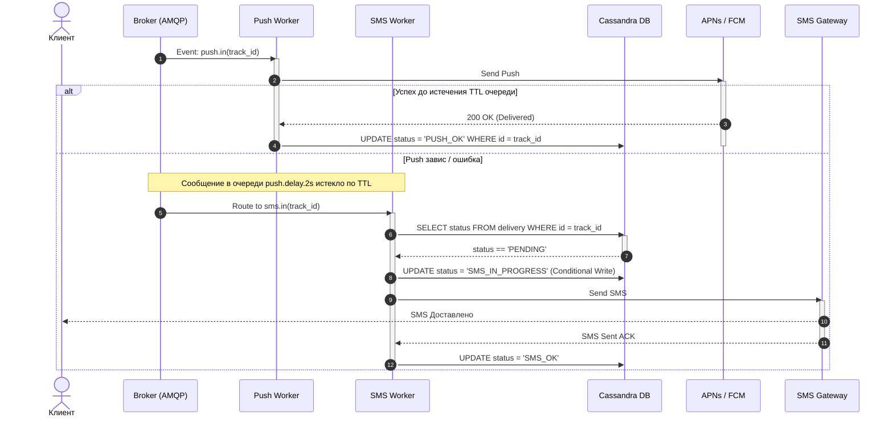
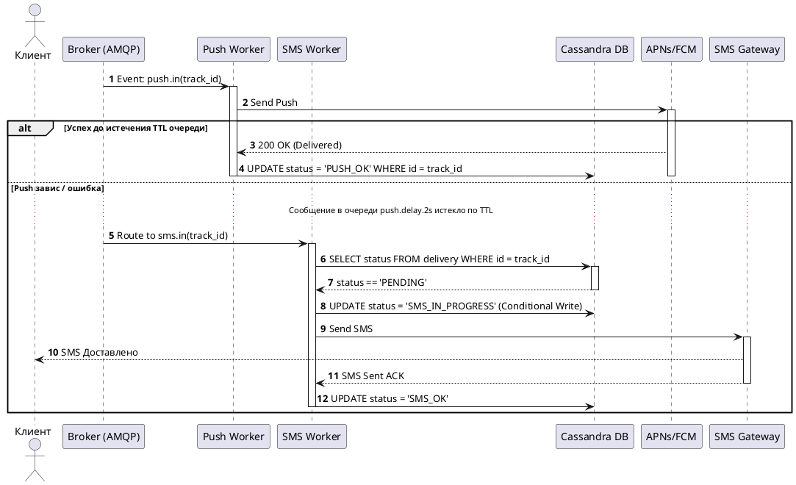

# Домашнее задание №4: Notification Platform

## Архитектурное проектирование отказоустойчивой платформы уведомлений онлайн-банка

---

## ЧАСТЬ I. Архитектурный фундамент (Задания 1–7)

### 1. Функциональные требования (FR)

| ID        | Требование                                                        | Описание поведения системы                                                                                                                                                                                                    | Связь с бизнес-целями                                                           |
| --------- | ----------------------------------------------------------------- | ----------------------------------------------------------------------------------------------------------------------------------------------------------------------------------------------------------------------------- | ------------------------------------------------------------------------------- |
| **FR-01** | **Каскадная маршрутизация (Smart Failover)**                      | Если доставка уведомления в приоритетный канал (Push) не подтверждена за отведенный интервал времени или завершилась ошибкой, система автоматически отправляет уведомление в резервный канал (SMS).                           | Обеспечение 100% доставки критичных уведомлений; оптимизация расходов на связь. |
| **FR-02** | **Дедупликация и защита от повторной отправки**                   | Система отсекает повторные запросы на отправку одного и того же события от сервисов-источников и гарантирует, что пользователь не получит дублирующее сообщение даже при сбоях сети или повторных попытках (retries).         | Снижение количества жалоб на 30%; улучшение пользовательского опыта.            |
| **FR-03** | **Управление пользовательскими предпочтениями и Opt-Out**         | Система предоставляет API и интерфейс управления подписками. Пользователь может отключить маркетинговые и сервисные рассылки или выбрать предпочтительный канал доставки. Транзакционные уведомления отключить запрещено.     | Увеличение retention на 15%; снижение жалоб на спам на 30%.                     |
| **FR-04** | **Приоритезация и изоляция очередей**                             | Система разделяет потоки уведомлений по классам критичности (транзакционные, сервисные, маркетинговые). Транзакционные сообщения обрабатываются вне общей очереди и имеют абсолютный приоритет.                               | Обеспечение мгновенной доставки критичных сообщений при любых нагрузках.        |
| **FR-05** | **Контроль частоты отправки (Frequency Capping / Rate Limiting)** | Система ограничивает максимальное число маркетинговых и сервисных сообщений на одного пользователя в единицу времени (например, не более 2 рекламных push в сутки) и блокирует отправку рекламы в ночные часы («тихие часы»). | Снижение оттока пользователей (Retention +15%); снижение жалоб на 30%.          |
| **FR-06** | **Сквозное отслеживание статуса доставки (Delivery Tracking)**    | Система принимает и фиксирует статусы доставки от внешних шлюзов (APNs/FCM, SMS-агрегаторы, SMTP) и предоставляет статус доставки вызывающим сервисам.                                                                        | Прозрачность доставки критичных транзакций; наблюдаемость.                      |

---

### 2. Нефункциональные требования (NFR)

| ID         | Атрибут качества                       | Измеримая метрика                                                                                     | Критерий приемки                                                                                                                                                                               |
| ---------- | -------------------------------------- | ----------------------------------------------------------------------------------------------------- | ---------------------------------------------------------------------------------------------------------------------------------------------------------------------------------------------- |
| **NFR-01** | **Performance (Latency)**              | Сквозное время доставки транзакционного уведомления (от вызова API банка до отправки шлюзу оператора) | $p95 \le 1.0\text{ сек}$, $p99 \le 2.0\text{ сек}$.                                                                                                                                            |
| **NFR-02** | **Reliability & Availability**         | Доступность API приема уведомлений и подсистемы доставки                                              | Availability $\ge 99.99\%$ (не более 52.6 минут простоя в год). SLA доставки критичных уведомлений: $\ge 99.999\%$.                                                                            |
| **NFR-03** | **Scalability & Throughput**           | Пропускная способность при пиковых нагрузках                                                          | Штатная нагрузка $\ge 3\,500\text{ RPS}$; удержание импульсной нагрузки маркетинговой кампании до $1\,000\,000$ сообщений за 15 минут ($\sim 1\,110\text{ RPS}$) без роста latency транзакций. |
| **NFR-04** | **Data Consistency & Deduplication**   | Окно гарантии идемпотентности                                                                         | Окно дедупликации $\ge 24\text{ часов}$. Вероятность отправки дубликата пользователю $\le 0.001\%$.                                                                                            |
| **NFR-05** | **Cost Efficiency**                    | Доля дорогостоящих каналов (SMS)                                                                      | При активном мобильном приложении пользователя доля SMS не должна превышать $5\text{--}8\%$ от всего объема критичных уведомлений за счет каскада.                                             |
| **NFR-06** | **Fault Tolerance & Circuit Breaking** | Время переключения на резервного провайдера при деградации основного                                  | При превышении порога ошибок шлюза $> 5\%$ за 30 секунд трафик переключается на альтернативного агрегатора за время $\le 3\text{ сек}$.                                                        |

---

### 3. Архитектурно значимые требования (ASR)

#### ASR-1: Сверхнизкая задержка и строгий SLA доставки транзакций в условиях массовых рассылок

- **Связанные требования:** FR-04, NFR-01, NFR-03.
- **Почему влияет на архитектуру:**
  Требует физической изоляции ресурсов: отдельные очереди/топики, отдельные пулы воркеров и выделенные сетевые коннекторы для транзакционного трафика (паттерн _Bulkhead_). Маркетинговые рассылки на 1 млн пользователей не должны влиять на доставку OTP-кодов и уведомлений о списаниях (проблема «Noisy Neighbor»).

#### ASR-2: Кросс-канальный Failover с гарантией At-Least-Once без дублирования (Idempotent Cascade)

- **Связанные требования:** FR-01, FR-02, NFR-02, NFR-04.
- **Почему влияет на архитектуру:**
  Требует распределенного управления состоянием (State Machine / Saga) с распределенными блокировками или атомарными проверками статуса. Если Push задерживается в сети, а система переключается на SMS, необходимо исключить ситуацию, при которой абонент получит и Push, и SMS с одним и тем же кодом авторизации.

#### ASR-3: Отказоустойчивость к деградации и сбоям внешних провайдеров

- **Связанные требования:** FR-06, NFR-02, NFR-06.
- **Почему влияет на архитектуру:**
  SMS-агрегаторы, Apple APNs и Google FCM находятся вне зоны контроля банка. Архитектура обязана поддерживать пул резервных провайдеров (Multi-vendor SMS), паттерны _Circuit Breaker_, _Retry with Exponential Backoff and Jitter_, а также асинхронную обработку отложенных статусов доставки (DLR Webhooks).

---

### 4. Ключевые архитектурные вопросы

1. **Вопрос 1: Как скоординировать процесс кросс-канального каскада - через централизованную оркестрацию или распределенную хореографию?**
   - _Порождающие ASR:_ ASR-1, ASR-2.
   - _Важность:_ При хореографии логика таймеров и failover размазывается по брокерам и сервисам каналов, что усложняет аудит и повышает риск гонок (race conditions). При оркестрации нужен высокопроизводительный координатор с сохранением состояния (State Storage), не создающий bottleneck.

2. **Вопрос 2: Как обеспечить идемпотентность и исключить отправку дубликатов при пограничных сетевых задержках?**
   - _Порождающие ASR:_ ASR-2, NFR-04.
   - _Важность:_ Если статус доставки Push-уведомления задерживается из-за сети на стороне клиента, а платформа по таймауту отправляет SMS, банк несет финансовые расходы на SMS, а клиент раздражается от дубля. Необходим механизм отзыва (push revocation) или короткоживущих распределенных блокировок/лизов (leases).

3. **Вопрос 3: Как гарантировать безопасность и соответствие регуляторным нормам при работе с конфиденциальными транзакционными данными?**
   - _Порождающие ASR:_ ASR-1, NFR-02 (Security/Compliance).
   - _Важность:_ Уведомления содержат остатки по счетам, персональные данные (ФЗ-152) и OTP-коды. Архитектура должна разделять метаданные маршрутизации и зашифрованный payload, а также ограничивать срок хранения (TTL) секретов в логах и БД.

---

### 5. Архитектурные последствия ASR



- **Для ASR-1 (Изоляция и задержка):**
  - Разделение шины сообщений на изолированные кластеры/топики: `notifications.transactional`, `notifications.service`, `notifications.marketing`.
  - Приоритетные воркеры с зарезервированными ресурсами CPU/RAM в Kubernetes.
  - In-memory кэш (Redis Cluster) для мгновенной валидации сессий, push-токенов и настроек без походов в тяжелые РСУБД.
- **Для ASR-2 (Failover и дедупликация):**
  - Введение ключа идемпотентности (`idempotency_key = hash(user_id, event_type, transaction_id)`).
  - Централизованный компонент управления состоянием доставки каждого сообщения с TTL и жесткими статусами (`PENDING`, `SENT`, `DELIVERED`, `FAILED`, `CANCELLED`).
- **Для ASR-3 (Отказоустойчивость к внешним провайдерам):**
  - Внедрение интеграционного слоя провайдеров с паттерном _Circuit Breaker_ (Resilience4j / Envoy).
  - Наличие минимум двух независимых SMS-шлюзов с автоматическим переключением трафика.
  - Dead Letter Queue (DLQ) для сообщений, исчерпавших лимит повторов, с ручным/полуавтоматическим разбором инцидентов.

---

### 6. Архитектурные решения, которые НЕ подходят

#### Решение 1: Синхронная каскадная доставка в рамках одного HTTP-запроса сервиса-источника

- **Суть:** Сервис платежей вызывает `POST /notify`, а платформа уведомлений синхронно ждет ответ от Push-шлюза, при ошибке синхронно ждет ответ от SMS-шлюза и только потом отвечает платежному сервису.
- **Нарушаемые ASR:** ASR-1, ASR-3, NFR-01, NFR-02.
- **Почему не подходит:** Таймаут внешних шлюзов (APNs, SMS) может достигать 5–10 секунд. Синхронные цепочки быстро приведут к исчерпанию пула потоков в вызывающих микросервисах банка (каскадный отказ всей системы). Платформа обязана принимать запрос асинхронно за $< 50\text{ мс}$ и возвращать `202 Accepted`.

#### Решение 2: Единая общая очередь (Single Shared Queue) для всех типов уведомлений

- **Суть:** Все сервисы складывают транзакции, рекламные рассылки и сервисные уведомления в один общий топик Kafka / очередь RabbitMQ.
- **Нарушаемые ASR:** ASR-1, NFR-01, NFR-03.
- **Почему не подходит:** Маркетинговая кампания на 1 млн сообщений вызовет эффект очереди (head-of-line blocking). Транзакционное уведомление о списании встанет в конец очереди и будет доставлено через десятки минут, что грубо нарушает SLA ($p99 \le 2.0\text{ с}$) и блокирует проведение безопасных платежей.

#### Решение 3: Параллельная веерная отправка (Broadcast / Fan-out) во все каналы одновременно

- **Суть:** Для минимизации задержки и гарантии доставки отправлять Push и SMS одновременно в момент наступления события.
- **Нарушаемые ASR:** NFR-05 (Cost Efficiency), FR-02 (Бизнес-цель: снижение жалоб).
- **Почему не подходит:** SMS в 20–30 раз дороже Push. Отправка SMS на каждое событие приведет к многомиллионным неоправданным затратам бюджета банка и вызовет раздражение клиентов от получения одинаковых сообщений на телефон в двух каналах сразу.

---

### 7. Неопределённости и архитектурные риски

| Неопределенность / Риск                                          | В чем заключается опасность                                                                                                                                                                                                                         | Как проверить и нивелировать                                                                                                                                                                                                                                                                            |
| ---------------------------------------------------------------- | --------------------------------------------------------------------------------------------------------------------------------------------------------------------------------------------------------------------------------------------------- | ------------------------------------------------------------------------------------------------------------------------------------------------------------------------------------------------------------------------------------------------------------------------------------------------------- |
| **Задержка получения статусов доставки (DLR) от Push-сетей**     | APNs и FCM не гарантируют мгновенного возврата DLR о вручении сообщения на экран смартфона (устройство может быть временно офлайн). Если ждать подтверждения слишком долго - задержится fallback на SMS; если ждать мало - уйдет дорогой SMS-дубль. | **Проверка:** Натурный бенчмарк и сбор статистики распределения времени доставки Push по активным пользователям банка.<br>**Решение:** Разделение логики: ожидание статуса `ACK` от шлюза (транспорт принят, таймаут 1.5–2.5 сек) и поддержка фонового отзыва (Silent Push revoke) при эскалации в SMS. |
| **Пропускная способность и троттлинг SMS-шлюзов**                | Операторы связи имеют жесткие лимиты на прием входящего SMS-трафика (TPS limits). В моменты пиков SMS-агрегатор может отвечать `429 Too Many Requests`.                                                                                             | **Проверка:** Нагрузочное тестирование контрактов агрегаторов; аудит лимитов каждого оператора (МТС, Билайн, МегаФон и др.).<br>**Решение:** Multi-vendor роутинг (балансировка между 2–3 агрегаторами) + локальный rate limiter с приоритетом транзакционных SMS перед маркетинговыми.                 |
| **Доставка устаревших критических данных (Stale Notifications)** | При сетевых сбоях транзакционное сообщение (например, одноразовый SMS-код подтверждения) может зависнуть в очередях оператора и дойти через 10 минут, когда операция уже отменена.                                                                  | **Проверка:** Тестирование сценариев восстановления очередей при длительном сбое сетевого стыка.<br>**Решение:** Установка строгого TTL (Time-To-Live) на уровне полезной нагрузки и на стороне SMS-шлюза (отбрасывание сообщений старше 120 секунд).                                                   |

---

---

## ЧАСТЬ II. RFC: Гарантированная доставка критичных уведомлений с кросс-канальным failover (Задание 8)

```
RFC-2026-NOTIF-001
Тема: Проектирование механизма гарантированной доставки критичных (транзакционных)
      уведомлений с автоматическим кросс-канальным failover
Статус: PROPOSED
Автор: Архитектурная группа платформы уведомлений
Целевая система: Notification Platform (Core Delivery Subsystem)
```

---

### 1. Summary (Краткое резюме)

Настоящий RFC описывает архитектуру подсистемы гарантированной доставки транзакционных уведомлений онлайн-банка. Решение обеспечивает:

- Доставку критичных сообщений хотя бы через один доступный канал (Push $\to$ SMS).
- Автоматический failover при сбое или таймауте за время не более 2.5–3.5 секунд.
- Исключение отправки дублирующих сообщений при пограничных сетевых задержках.
- Изоляцию транзакционного трафика от сервисного и маркетингового.
- Снижение затрат на связь за счет удержания доли SMS-трафика на уровне $< 7\%$.

---

### 2. Контекст и проблематика

В существующей инфраструктуре банка каждый сервис отправляет уведомления самостоятельно через разрозненные внешние шлюзы.

- **Проблемы:** Отсутствует единый контроль очередей, спам-фильтрация и дедупликация. В моменты проведения маркетинговых акций транзакционные уведомления (коды подтверждения платежей, оповещения о списаниях) застревают в очередях шлюзов.
- **Стоимость:** Отсутствие каскада приводит к тому, что сервисы отправляют дорогие SMS даже тем пользователям, у которых установлено мобильное приложение с активным Push-токеном.

---

### 3. Цели и не-цели (Goals & Non-Goals)

#### Цели (Goals):

- Гарантия доставки critical-уведомления: 99.999% при наличии хотя бы одного валидного контакта клиента.
- Время доставки транзакционного сообщения: $p95 \le 1.0\text{ с}$, $p99 \le 2.0\text{ с}$ (для Push); при failover в SMS: суммарно не более $5.0\text{ с}$.
- Предотвращение дублирования сообщений при переключении каналов.
- Поддержка пользовательских настроек (транзакционные уведомления - неотключаемые; сервисные/маркетинговые - с возможностью Opt-Out).

#### Не-цели (Non-Goals):

- Проектирование визуального конструктора маркетинговых шаблонов.
- Проектирование системы биллинга и взаиморасчетов с внешними операторами связи (учитываются только метрики расхода).
- Гарантия доставки в случае, если телефон абонента выключен или находится вне зоны действия сети дольше своего TTL.

---

### 4. Оценка нагрузки и сайзинг (Capacity Estimation & Sizing)

#### 4.1. Входные параметры

- **MAU:** 10 000 000 пользователей.
- **DAU:** 3 000 000 пользователей.
- **Peak Concurrent Users (CCU):** 300 000 пользователей.
- **Среднее число уведомлений на активного пользователя в сутки:**
  - Транзакционные: 2 сообщ/день
  - Сервисные: 3 сообщ/день
  - Маркетинговые: 5 сообщ/день
  - **Итого:** 10 сообщений на пользователя в день.

#### 4.2. Расчет пропускной способности (Throughput / RPS)

- **Суточный объем уведомлений:**
  $$V_{total} = 3\,000\,000 \times 10 = 30\,000\,000\text{ сообщений/сутки}$$
  - Транзакционные: $3\,000\,000 \times 2 = 6\,000\,000\text{ сообщ/сутки}$
  - Сервисные: $3\,000\,000 \times 3 = 9\,000\,000\text{ сообщ/сутки}$
  - Маркетинговые: $3\,000\,000 \times 5 = 15\,000\,000\text{ сообщ/сутки}$

- **Средний RPS системы (равномерно по 24 часам):**
  $$RPS_{avg} = \frac{30\,000\,000}{86\,400} \approx 347\text{ RPS}$$

- **Пиковый RPS для транзакционных сообщений:**
  Транзакционная активность концентрируется в интервале активного дня (12 часов, с коэффициентом неравномерности $k_{peak} = 4.5$ в моменты пиков покупок/CCU 300k):
  $$RPS_{tx\_avg} = \frac{6\,000\,000}{43\,200} \approx 139\text{ RPS}$$
  $$RPS_{tx\_peak} = 139 \times 4.5 \approx 625\text{ RPS}$$
  _С запасом на пиковые распродажи (Black Friday, зарплатные дни) закладываемся на $RPS_{tx_max} = 1\,500\text{ RPS}$.\_

- **Импульсная нагрузка массовых маркетинговых кампаний:**
  По условию: кампания до 1 000 000 пользователей.
  При отправке за 15 минут ($900\text{ сек}$):
  $$RPS_{mkt\_burst} = \frac{1\,000\,000}{900} \approx 1\,111\text{ RPS}$$
  _Суммарный пиковый входной поток на платформу:_
  $$RPS_{total\_peak} = RPS_{tx\_peak} + RPS_{mkt\_burst} + RPS_{srv} \approx 1\,500 + 1\,111 + 400 \approx 3\,000\text{--}3\,500\text{ RPS}$$

#### 4.3. Оценка хранилища и сетевой полосы (Storage & Network)

- Средний размер одного сообщения (метаданные + текст + разметка): $\approx 1.5\text{ КБ}$.
- **Суточный объем полезных данных:**
  $$Storage_{day} = 30\,000\,000 \times 1.5\text{ КБ} = 45\text{ ГБ/сутки}$$
- **С учетом индексов, истории статусов доставки (DLR events) и аудита ($\times 3$):**
  $$Storage_{total\_day} \approx 135\text{ ГБ/сутки}$$
- **Хранение оперативных данных (Hot tier, 90 дней):**
  $$Storage_{90d} \approx 135\text{ ГБ} \times 90 \approx 12.15\text{ ТБ}$$
- **Сетевая полоса (Bandwidth) на пике:**
  $$Bandwidth_{peak} = 3\,500\text{ RPS} \times 1.5\text{ КБ} \times 8\text{ бит} \approx 42\text{ Мбит/с}$$
  _(С учетом DLR-колбэков и внутренней репликации брокеров: $\approx 150\text{ Мбит/с}$, что легко укладывается в стандартные 10 Gbps интерфейсы ЦОД)._

---

### 5. Архитектурные решения (Сравнение 2-х вариантов)

---

#### ВАРИАНТ 1 (Рекомендуемый): Оркестрация на базе State Machine и Delayed Topics

##### 1. Описание архитектуры

Архитектура построена на паттерне **Оркестратор доставки (Delivery Orchestrator)**.

1. Принимающий API регистрирует запрос, проверяет дедупликацию и сохраняет состояние перехода в распределенное хранилище (PostgreSQL / ScyllaDB + Redis).
2. Запрос публикуется в приоритетную шину Apache Kafka (топик `notifications.tx.fastpath`).
3. Специализированный микросервис **Cascade Router** инициирует отправку первого шага (Push). Одновременно в тайм-координатор (Kafka Delayed Topic / Redelivery Scheduler) отправляется отложенное событие проверки статуса (Wait Lease).
4. Если за установленный таймаут ($2.0\text{ сек}$) Push-адаптер получил успешный `ACK/DELIVERED` от APNs/FCM, состояние в Redis обновляется на `DELIVERED`, а отложенный чек отменяется/игнорируется.
5. Если по истечении таймаута статус Push остается `UNKNOWN` или зафиксирован `FAILED`, Cascade Router мгновенно блокирует повторную отправку через Redis distributed lock, отзывает Push и направляет задачу в `notifications.tx.sms.fallback`.

##### 2. C4 Container Diagram (Вариант 1: Orchestration)



##### 3. Sequence Diagrams (Сценарии взаимодействия)

###### 3.1. Основной успешный сценарий (Happy Path: Push Delivered)



<details>
<summary><b>Исходный код PlantUML (по требованию ТЗ)</b></summary>



</details>

###### 3.2. Сценарий сбоя и кросс-канального Failover (Push Failed / Timeout -> SMS Success)



<details>
<summary><b>Исходный код PlantUML (по требованию ТЗ)</b></summary>



</details>

##### 4. Стек технологий и обоснование

| Компонент                      | Выбранная технология                         | Обоснование выбора                                                                                                                      |
| ------------------------------ | -------------------------------------------- | --------------------------------------------------------------------------------------------------------------------------------------- |
| **API Gateway**                | Go (Gin / Fiber) + Envoy                     | Минимальный оверхед по памяти, время ответа $< 10\text{ мс}$, встроенные механизмы Rate Limiting и валидации JWT/mTLS.                  |
| **Очередь сообщений**          | Apache Kafka                                 | Высокая пропускная способность ($> 100k\text{ msg/sec}$), строгий порядок партиционирования по `user_id`, сохранение истории.           |
| **Кэш состояния и блокировок** | Redis Cluster (In-Memory)                    | latency операций $< 1.5\text{ мс}$, поддержка атомарных Lua-скриптов для CAS (Compare-And-Swap) переходов статусов и distributed locks. |
| **Основное хранилище аудита**  | PostgreSQL с шардированием (Citus / Patroni) | Строгая консистентность (ACID), партиционирование таблиц истории по дням (pg_partman), надежный аудит финтех-уровня.                    |
| **Push/SMS воркеры**           | Go                                           | Эффективная работа с сетевыми соединениями HTTP/2 (APNs) и SMPP протоколами, низкое потребление CPU.                                    |

---

#### ВАРИАНТ 2: Реактивная хореография (Event Choreography via Dead Letter & Delay Exchanges)

##### 1. Описание архитектуры

В данном варианте отсутствует централизованный Orchestrator. Вся логика построена на **событийной хореографии** вокруг брокера сообщений с поддержкой отложенной доставки (RabbitMQ с Delayed Message Plugin или Apache Pulsar):

1. API Gateway отправляет событие `NotificationRequested` сразу в топик Push-воркера.
2. Push-воркер пытается отправить сообщение. При получении ошибки он сам отправляет событие `PushDeliveryFailed` в очередь SMS-воркера.
3. Для обработки таймаута сообщение параллельно кладется в очередь задержки `push.timeout.queue` с TTL = 2.5 секунды. По истечении TTL сообщение перемещается в очередь `sms.delivery.queue`.
4. Дедупликация и предотвращение гонки осуществляются через условную запись в Distributed KV Store (Cassandra или DynamoDB).

##### 2. C4 Container Diagram (Вариант 2: Choreography)



##### 3. Sequence Diagrams (Сценарии взаимодействия)

###### 3.1. Основной сценарий и Failover в хореографии



<details>
<summary><b>Исходный код PlantUML (по требованию ТЗ)</b></summary>



</details>

##### 4. Стек технологий (Вариант 2)

- **Message Broker:** RabbitMQ с плагином `rabbitmq_delayed_message_exchange`.
- **State / Deduplication Store:** Apache Cassandra (высокая скорость записи, eventual consistency, TTL на уровне колонок).
- **Workers:** Go (микросервисы с подпиской на AMQP exchange).

---

### 6. Сравнительный анализ архитектурных решений (Trade-Off Matrix)

| Критерий сравнения                                    | Вариант 1: Оркестрация (State Machine + Kafka + Redis)                                        | Вариант 2: Хореография (RabbitMQ Delay + Cassandra)                                                             | Победитель    |
| ----------------------------------------------------- | --------------------------------------------------------------------------------------------- | --------------------------------------------------------------------------------------------------------------- | ------------- |
| **Предсказуемость задержки (Latency)**                | Высокая ($< 2.0\text{ с}$). Оркестратор мгновенно управляет отменой и переходами.             | Средняя ($2.5\text{--}4.0\text{ с}$). Ограничена жестким шагом дискретизации TTL очереди.                       | **Вариант 1** |
| **Гарантия отсутствия дублей (Race Conditions)**      | Высокая. Атомарный CAS в Redis исключает отправку SMS, если Push подтвержден на 1.99 секунде. | Ниже. Возможна коллизия при параллельном чтении/записи из Cassandra из-за Eventual Consistency.                 | **Вариант 1** |
| **Сложность разработки и сопровождения**              | Средняя. Логика каскада собрана в одном месте (Orchestrator). Легко дебажить и поддерживать.  | Высокая. Поведение системы размазано между брокером, очередями задержек и воркерами.                            | **Вариант 1** |
| **Нагрузка на инфраструктуру при массовых рассылках** | Низкая. Kafka рассчитана на миллионы сообщений с линейным дисковым чтением.                   | Средняя/Высокая. Встроенные очереди задержек RabbitMQ сильно нагружают RAM и Erlang VM при миллионных очередях. | **Вариант 1** |
| **Автономность компонентов**                          | Ниже (оркестратор является центральным звеном).                                               | Выше (воркеры слабо связаны между собой).                                                                       | **Вариант 2** |

---

### 7. Выбор и обоснование финального решения

**Выбран ВАРИАНТ 1 (Оркестрация на базе State Machine, Kafka и Redis Cluster).**

#### Обоснование:

1. **Финтех-критичность и исключение дублей:** В банковском секторе недопустима ситуация, когда клиенту приходит и Push, и SMS с кодом подтверждения одной и той же операции. Централизованный State Machine с In-Memory блокировками в Redis дает строгие гарантии перехода состояний и позволяет атомарно отменить SMS при запоздалом успехе Push.
2. **Устойчивость к маркетинговым всплескам:** Kafka естественным образом выдерживает нагрузку в 1 000 000 сообщений за 15 минут за счет сегментированных логов, тогда как очереди с отложенной доставкой в RabbitMQ при подобных спайках деградируют по памяти (memory pressure).
3. **Наблюдаемость и аудит (Compliance):** В варианте с оркестратором статус жизненного цикла каждого сообщения виден в одной точке в реальном времени.

---

### 8. Детальные инженерные механизмы выбранного решения

#### 8.1. Идемпотентность и исключение дубликатов (Deduplication)

Каждое критичное уведомление обязано иметь уникальный бизнес-ключ:

```
Idempotency-Key = SHA256(source_service + ":" + event_type + ":" + external_transaction_id)
```

- **Алгоритм работы:**
  1. При поступлении запроса API Gateway выполняет команду:
     `SET idemp:{key} {request_id} NX EX 86400`
  2. Если ключ уже существует, шлюз возвращает вызывающему сервису ранее сохраненный статус (`200 OK` с `track_id`) без повторной постановки в очередь.
  3. Для предотвращения дублей между каналами внутри каскада переход статуса выполняется через атомарный скрипт:
     ```lua
     -- Проверка: если сообщение уже доставлено через Push, запретить SMS
     local current = redis.call('GET', KEYS[1])
     if current == 'DELIVERED' or current == 'CANCELLED' then
         return 0
     else
         redis.call('SET', KEYS[1], ARGV[1], 'EX', 3600)
         return 1
     end
     ```

#### 8.2. Тайминги каскада и жизненный цикл (Failover Timeout)

- **Шаг 1: Push (Fast-Path):**
  - Отправка в APNs/FCM.
  - Тайм-аут ожидания ACK от шлюза: **2.0 секунды**.
- **Шаг 2: Анализ результата:**
  - Получен `ACK` $\to$ статус `DELIVERED`, каскад завершен.
  - Получена ошибка (токен невалиден, `Unregistered`, `DeviceOffline`, 5xx от APNs) $\to$ **мгновенный failover в SMS** без ожидания таймаута (задержка $< 100\text{ мс}$).
  - Таймаут 2.0 секунды истек без ответа $\to$ эскалация в SMS.
- **Шаг 3: SMS Fallback:**
  - Отправка через первичного SMS-агрегатора (SLA доставки SMS оператором $\le 3.0\text{ сек}$).
  - При ошибке агрегатора (HTTP 5xx, Network Timeout 1.0 сек) $\to$ переключение через Circuit Breaker на резервного SMS-агрегатора.
- **Time-To-Live (TTL):** Для транзакционных OTP-сообщений выставляется жесткий TTL = 120 секунд. По истечении TTL сообщение удаляется из очередей и не отправляется абоненту.

#### 8.3. Пользовательские предпочтения и матрица Opt-Out

| Тип уведомления               | Примеры                                                       | Можно ли отключить?     | Доступные каналы | Каскадная схема                                         |
| ----------------------------- | ------------------------------------------------------------- | ----------------------- | ---------------- | ------------------------------------------------------- |
| **Транзакционные (Critical)** | Списание, перевод, вход в ЛК, 3D-Secure OTP, блокировка карты | **НЕТ (Запрещено)**     | Push, SMS        | Push $\to$ Failover в SMS                               |
| **Сервисные (Important)**     | Статус заявки на кредит, выпуск карты, готовность документов  | **ДА (выборочно)**      | Push, Email, SMS | Push $\to$ Failover в Email                             |
| **Маркетинговые (Promo)**     | Скидки партнеров, кэшбэк месяца, персональные предложения     | **ДА (полный Opt-Out)** | Push, Email      | Только один выбранный канал (без платного SMS fallback) |

- Для маркетинговых сообщений действует ограничение **Frequency Capping**: не более 2 push-уведомлений в день на клиента, с блокировкой доставки с 22:00 до 08:00 по местному часовому поясу клиента.

---

### 9. Наблюдаемость (Observability) и метрики

#### 9.1. Ключевые метрики (Prometheus):

- `notifications_received_total{type, channel}` - счетчик входящих запросов.
- `notifications_delivered_total{type, channel, provider}` - счетчик успешных доставок.
- `delivery_latency_seconds{type, channel}` - гистограмма времени сквозной доставки ($p50, p95, p99$).
- `failover_transitions_total{from_channel, to_channel, reason}` - количество переключений на резервный канал (Push $\to$ SMS).
- `provider_circuit_breaker_state{provider}` - статус доступности внешних шлюзов (0 = Closed/OK, 1 = Open/Failed).

#### 9.2. Трассировка (OpenTelemetry):

- Каждый запрос маркируется `trace_id` и `span_id`. Идентификатор передается через HTTP-заголовки, метаданные сообщений Kafka и DLR-колбэки от провайдеров, что обеспечивает сквозной трейсинг пути сообщения от платежного шлюза до сотового оператора.

#### 9.3. Алертинг (SLO Alerts):

- **P0 Alert:** Доставка транзакционных уведомлений $p99 > 3.0\text{ сек}$ на протяжении 2 минут.
- **P0 Alert:** Доля ошибок доставки транзакционных уведомлений $> 0.1\%$ за 5 минут.
- **P1 Alert:** Всплеск переключений в SMS-каскад ($> 15\%$ от общего транзакционного объема), сигнализирующий о сбое на стороне APNs/FCM.

---

### 10. Риски решения и компромиссы (Limitations & Trade-Offs)

1. **Компромисс «Задержка failover против стоимости SMS»:**
   - Если поставить таймаут ожидания Push равным 1 секунде - возрастет надежность, но увеличится число ложных переключений в дорогой SMS при медленном мобильном интернете у клиента.
   - _Решение:_ Выбран оптимум **2.0 секунды**, гарантирующий удержание доли SMS ниже $7\%$ при соблюдении общего лимита доставки в пределах $5$ секунд.
2. **Зависимость от единого кэша состояний (Redis):**
   - _Риск:_ Выход из строя Redis Cluster парализует механизм блокировок и дедупликации.
   - _Минимизация:_ Развертывание Redis Cluster в Multi-AZ конфигурации с Sentinel/Master-Replica и fallback на локальный in-memory кэш экземпляра воркера (Caffeine) с безопасным переходом в режим «Fail-Open» (лучше отправить дубль, чем не доставить транзакцию вовсе).
